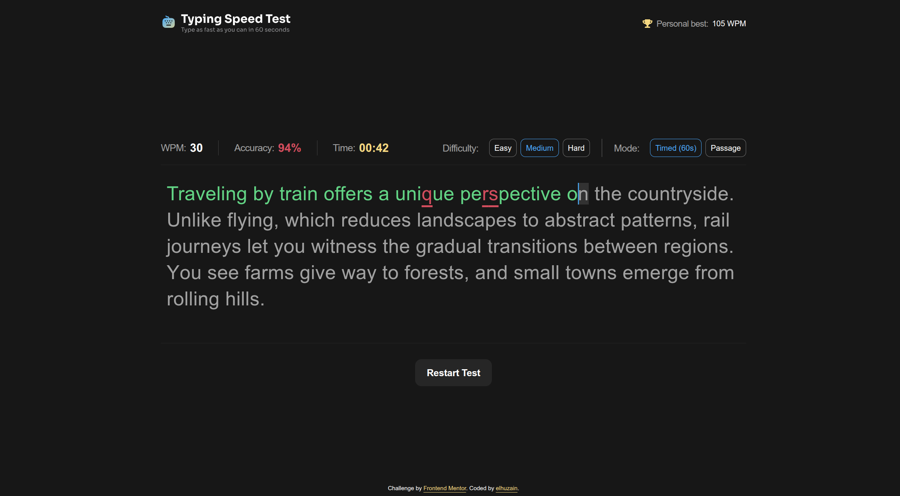

# Frontend Mentor - Typing Speed Test solution

This is a solution to the [Typing Speed Test challenge on Frontend Mentor](https://www.frontendmentor.io/challenges/typing-speed-test). Frontend Mentor challenges help you improve your coding skills by building realistic projects. 

## Table of contents

- [Overview](#overview)
  - [The challenge](#the-challenge)
  - [Screenshot](#screenshot)
  - [Links](#links)
- [My process](#my-process)
  - [Built with](#built-with)
  - [What I learned](#what-i-learned)
  - [Continued development](#continued-development)
  - [AI Collaboration](#ai-collaboration)
- [Author](#author)

## Overview

### The challenge

Users should be able to:

- View the optimal layout for the interface depending on their device's screen size
- See hover and focus states for all interactive elements on the page

### Screenshot

### Links

- Solution URL: [Solution](https://github.com/elhuzain/typing-speed-test)
- Live Site URL: [Live Preview](https://typing-speed-test.elhuzain.com)

## My process

### Built with

- Semantic HTML5 markup
- CSS custom properties
- Flexbox
- CSS Grid
- Mobile-first workflow
- [React](https://reactjs.org/) - JS library
- [Next.js](https://nextjs.org/) - React framework
- [TailwindCSS](https://tailwindcss.com/) - For styles

### What I learned

- Splitting passage text into individual characters made it possible to compare each keystroke with its corresponding letter and immediately preview correct, incorrect, and current-character states with different colors.
- Building sequenced animations with GSAP timelines provided practice with scoped selectors, staggered entrances, cleanup in React, and respecting reduced-motion preferences.

### Continued development

- Continue exploring efficient techniques for rendering and updating letter-by-letter text in longer passages.
- Refine interface animations so they remain expressive, performant, and accessible across different screen sizes and motion preferences.

### AI Collaboration

Codex (5.6 Sol) was used to assist with GSAP animation within this project as an added bonus

## Author

- Website - [elhuzain.com](https://elhuzain.com)
- Frontend Mentor - [@elhuzain](https://www.frontendmentor.io/profile/elhuzain)
